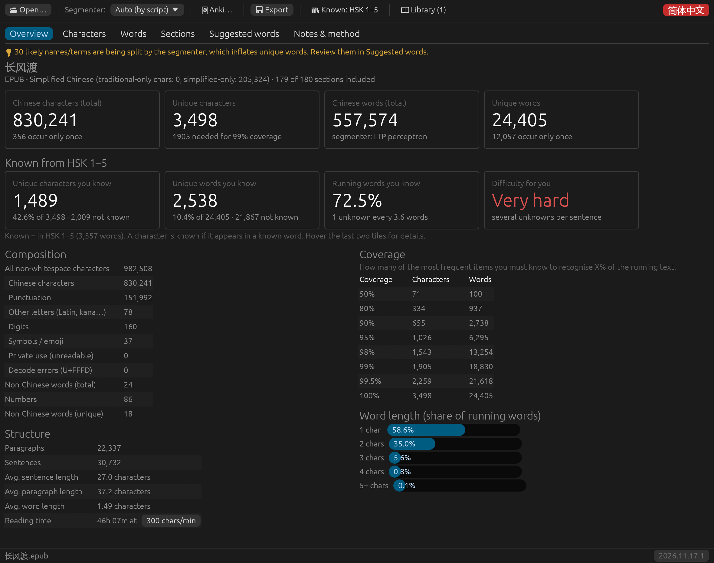

# hanstat

[](https://github.com/caocaochan/hanstat/actions/workflows/ci.yml)
[](https://github.com/caocaochan/hanstat/releases/latest)

How hard is this book for you? hanstat counts the characters and words of Chinese, Japanese and Korean `.epub` and `.txt` files and measures them against what you know: your Anki cards, vocabulary levels (HSK 3.0 and 2.0, TOCFL, JLPT, TOPIK levels) and word lists. It keeps a library of your books, suggests an order to read them in, and tracks the books you've read.

Runs on Windows, macOS and Linux. The Mac app's font handling and self-updating are by [@linlin56](https://github.com/linlin56), from [#1](https://github.com/caocaochan/hanstat/pull/1).



## Install

**Windows (x64):** download [`hanstat-x86_64-pc-windows-msvc.zip`](https://github.com/caocaochan/hanstat/releases/latest/download/hanstat-x86_64-pc-windows-msvc.zip), unzip it and run `hanstat.exe`. It isn't code-signed, so SmartScreen may ask you to confirm the first run.

**macOS (Apple Silicon, macOS 11+):** download [`hanstat-aarch64-apple-darwin.zip`](https://github.com/caocaochan/hanstat/releases/latest/download/hanstat-aarch64-apple-darwin.zip), unzip it and move `hanstat.app` to Applications. It isn't notarised: the first time, macOS refuses to open it; go to **System Settings → Privacy & Security** and click **Open Anyway**.

**Linux (x86-64):** download [`hanstat-x86_64-linux.flatpak`](https://github.com/caocaochan/hanstat/releases/latest/download/hanstat-x86_64-linux.flatpak) and install it with `flatpak install --user hanstat-x86_64-linux.flatpak` (or open it in your software centre). It brings its own CJK fonts. Under Wayland, files dropped on the window don't arrive; use **📂 Open…**.

hanstat updates itself on Windows and macOS (click the version in the status bar to check now, or to turn it off). On Linux, install the newer `.flatpak` the same way.

The first start downloads the Chinese segmenters (about 80 MB); Korean and Japanese books download their analysers (about 130–165 MB each) the first time you open one.

## Use

Open a book or drop it on the window. The language is detected and shown in the badge at the top right; Chinese is segmented with LTP (Simplified) or CKIP (Traditional), Japanese with Sudachi, Korean with Kiwi. In Chinese, idioms count as one word, and the rare non-words a segmenter makes by misplacing a boundary (木柯跑, 他/妈凭/什么) are split again into dictionary words and the book's own names. The tabs show the overview, every character and word with its count, the sections (untick front and back matter), and names the segmenter may have split.

**Reading.** **📕 Read** beside a Chinese EPUB's title opens it in a paginated reader with the book's own layout and pictures, one or two pages side by side, in the installed fonts you choose. It reopens where you left off. Drag to select text and use **Copy** from the right-click menu or press Ctrl+C. Hold Shift over a word to look it up in your Yomitan dictionaries (**Dictionaries** in the reader's bar imports them and keeps them up to date). The **+** beside a word adds it to Anki through AnkiConnect, greyed out when it is already there. With your own Azure Speech key, **Read aloud** can use an Azure neural voice, or, free and offline after a one-time download, Qwen3-TTS on your graphics card, which needs about 3.6 GB of graphics memory (a 4 GB card is just enough; 8 GB reads fastest). Choose **Play from here** from the right-click menu to start reading aloud at that sentence. The sentence heard is highlighted, the pages turn with it, and while reading you can click a word to jump to its sentence. A chapter or the whole book can be made ahead of time.

**What you know.** Click **🃏 Anki**, tick your decks and the field that holds the word: young and mature cards count as known (your collection is only read, never changed). Or click **📚** to tick vocabulary levels (HSK 3.0, HSK 2.0, TOCFL, JLPT, Kaishi 1.5k, 1–6급) or import word lists, and mark single words known with **+** in the Words tab. Each language keeps its own.

**Names.** Character names inflate the unknown words. **Suggested words** lists the likely names and terms the segmenter split or glued to other words; apply them, or type one into **Force a word**.

**Library.** Every book you open is added to **📖 Library**, with its length, the share of running words you know, its difficulty and reading time; click a column to sort. Rows update on their own when what you know changes. Click **✔** in the **Read** column once you've read a book: the most frequent of its words (90% of those it uses 10+ times, adjustable) count as known from then on, and it leaves the reading path.

**Reading path.** **Library → Reading path** orders the books of one language so that the words you study for one book make the next ones easier: before each, it lists the words to study until you know 95% of its running words (or a fixed number). Series are read in order, and **💾** saves a book's study list for Anki.

**Stats.** **Library → Stats** shows the library as a whole: how much of it you know, how hard each book is now, the books you've read, and the unknown words that the most books use.

**Writing style** (optional, Chinese only). Turn on **Rate writing style with a local AI model** in **⚙** to rate how hard each book's prose is beyond its words. The rating is shown against the other rated books of your Library (50% is their median, the plainest near 0%, the most literary near 100%), with a word for where it falls on its own: plain, typical, literary or very literary. It runs Qwen3.5-4B locally through llama.cpp (a 2.7 GB download; books never leave your computer) and counts toward the difficulty with the weight set in **⚙**.

## Anki add-on

[Hanstat TTS](https://ankiweb.net/shared/info/194815963) (code `194815963`) adds word and sentence audio to your Anki cards with hanstat's voices: the local Qwen3-TTS voice, including the voices you designed or imported, or Azure with the key saved in hanstat. Set up a voice in **Read aloud** first; hanstat doesn't need to be running.

## Command line

```
hanstat-cli file.epub [--anki] [--level N] [--known-list words.txt] [--json] [--words-csv f] [--library]
hanstat-cli --plan [--lang zh|ko|ja] [--target 95] [--study-lists DIR]
```

`hanstat-cli --help` lists every option. On macOS it's `hanstat.app/Contents/MacOS/hanstat-cli`; in the Flatpak, `flatpak run --command=hanstat-cli io.github.caocaochan.hanstat`.

## Data

Settings, the Library and your known words are in `%LOCALAPPDATA%\hanstat` (macOS: `~/Library/Application Support/hanstat`, Linux: `~/.local/share/hanstat`, Flatpak: `~/.var/app/io.github.caocaochan.hanstat/data/hanstat`); the models and saved analyses are there too on Windows and macOS, and in `~/.cache/hanstat` on Linux. [CHANGELOG.md](CHANGELOG.md) describes every feature and change in detail.

## Licence

MIT or Apache-2.0, at your option. Bundled data: OpenCC (Apache-2.0); jieba dictionary (MIT); general-language headwords from [CC-CEDICT](https://cc-cedict.org/wiki/), CC BY-SA 4.0 (see `data/CEDICT-LICENSE.txt`); idiom and word headwords (no definitions) from 新华成语大词典, 汉语成语源流大辞典, 现代汉语规范词典, 现代汉语词典 and 國語辭典簡編本 (see `data/Headwords-LICENSE.txt`); HSK list from the official syllabus via [ofou/hsk](https://github.com/ofou/hsk) (MIT); HSK 2.0 (2012) lists from [hskhsk.com](https://github.com/glxxyz/hskhsk.com) (MIT, see `data/HSK20-LICENSE.txt`); TOCFL list from [SC-TOP's 華語八千詞表](https://tocfl.edu.tw/tocfl/index.php/exam/download) (free download, no licence stated; only the words are bundled); JLPT list by Jonathan Waller (CC BY) with fixes from [stephenmk/yomitan-jlpt-vocab](https://github.com/stephenmk/yomitan-jlpt-vocab), CC BY-SA 4.0 (see `data/JLPT-LICENSE.txt`); Kaishi 1.5k headwords from [donkuri/Kaishi](https://github.com/donkuri/Kaishi) (no licence published); Korean levels from 국립국어원's [국제 통용 한국어 표준 교육과정 vocabulary list](https://www.korean.go.kr/front/reportData/reportDataView.do?mn_id=45&report_seq=932) (public work, Korean Copyright Act Art. 24-2). Downloaded models: [LTP](https://huggingface.co/LTP/legacy) is free for research and individual use (commercial use needs a licence from HIT-SCIR), [CKIP bert-tiny](https://huggingface.co/ckiplab/bert-tiny-chinese-ws) is GPL-3.0, [Kiwi](https://github.com/bab2min/Kiwi) and [SudachiDict](https://github.com/WorksApplications/SudachiDict) are Apache-2.0; for writing style, [Qwen3.5-4B](https://huggingface.co/Qwen/Qwen3.5-4B) (GGUF by [Unsloth](https://huggingface.co/unsloth/Qwen3.5-4B-GGUF)) is Apache-2.0 and [llama.cpp](https://github.com/ggml-org/llama.cpp) MIT. Book titles in exported images: [LXGW WenKai](https://github.com/lxgw/LxgwWenKai) Medium 1.530, bundled, SIL OFL 1.1 (see `assets/fonts/LXGWWenKai-LICENSE.txt`). Interface text on macOS and Linux: [Inter](https://github.com/rsms/inter) 4.1, bundled, SIL OFL 1.1 (see `assets/fonts/Inter-LICENSE.txt`). Fonts in the Linux Flatpak: [Noto Sans CJK](https://github.com/notofonts/noto-cjk) and [Plangothic](https://github.com/Fitzgerald-Porthmouth-Koenigsegg/Plangothic-Project), both SIL OFL 1.1.
